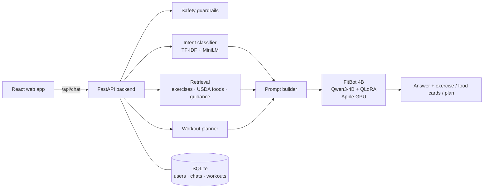

# FitBot – a local fitness assistant powered by a fine-tuned 4B language model

FitBot is a chat assistant for workouts, exercises, nutrition, sleep and recovery. It runs **entirely on your
own Mac**: a fine-tuned **Qwen3-4B** model answers questions, grounded in 871 real exercises (with photos) and
USDA nutrition data, with a safety layer for medical topics. There are no cloud AI APIs and no accounts with
third parties; your chats stay in a local SQLite database.

> FitBot provides general fitness and wellness information and is not a substitute for professional medical advice.

<!-- Demo video: coming soon -->

## Features

* **Chat about fitness**: workouts, exercises, weight loss, muscle gain, cardio, nutrition, hydration,
  pre/post-workout food, sleep, recovery, stretching, equipment and lifestyle, with follow-up questions
  ("I'm a beginner" → "I only have dumbbells").
* **Exercise cards with real photos** for all **871 exercises** from the public-domain free-exercise-db: target
  muscles, equipment, difficulty, step-by-step instructions and a safety tip.
* **Food cards with USDA FoodData Central values** (111 foods): macros, % Daily Value, vitamins and minerals per
  100 g or per household portion. Unknown values are never estimated.
* **Workout planner**: beginner to advanced, gym / home / dumbbells / bodyweight, 1-6 days a week, with
  sets, reps, rest and images.
* **My workouts**: save plans from the chat, log workouts, weekly activity chart, streaks and personal bests.
* **Safety guardrails** for emergencies, eating disorders, extreme diets, dehydration, PEDs, medication and injury
  diagnosis, plus a refusal for off-topic questions.
* Accounts with private chat history, optional profile (level, goal, diet, equipment) for personalised answers,
  👍/👎 feedback, read-aloud and voice input, and an installable web app (PWA).

## How it works



The backend detects the intent, retrieves the facts the answer needs (exercise data, USDA numbers, plan) and puts
them in the prompt, so the model writes the answer around real data instead of inventing it. The cards in the UI
come straight from the data, not from the model. Details: [docs/ARCHITECTURE.md](docs/ARCHITECTURE.md).

## The model

| | |
|---|---|
| Base model | [`Qwen/Qwen3-4B-Instruct-2507`](https://huggingface.co/Qwen/Qwen3-4B-Instruct-2507) (4.0 B parameters, Apache-2.0) |
| Fine-tuning | QLoRA: 4-bit NF4 base, LoRA r = 16 on all attention + MLP layers (33 M trainable parameters), 2 epochs |
| Data | FitBot dataset v2: 5,470 conversations (4,382 train / 527 validation / 561 test), built from 871 exercises, USDA foods, the planner and hand-written guidance; no external AI was used to write it |
| Trained on | NVIDIA RTX 4070 (12 GB), 76 min of training |
| Runs on | Apple Silicon Mac, float16 on the GPU (MPS); ~9-12 s per answer on an M5 with 16 GB |

| | Base Qwen3-4B | **FitBot 4B** | FitBot 360M (v1) |
|---|---:|---:|---:|
| Test perplexity | 12.81 | **1.62** | 2.45 |
| ROUGE-L, 97 v1 test questions | 0.228 | **0.604** | 0.488 |
| ROUGE-L, 80 new v2 test questions | 0.225 | **0.676** | – |
| Off-topic refusal rate | 0.00 | **1.00** | – |
| Full app test suites (163 checks) | – | **93-94 %** | 92 % |


More: [docs/EVALUATION.md](docs/EVALUATION.md) · [docs/MODEL_SELECTION.md](docs/MODEL_SELECTION.md) ·
[docs/TRAINING_GUIDE.md](docs/TRAINING_GUIDE.md).

## Requirements

* A Mac with **Apple Silicon** (M1 or newer) and **16 GB of memory** or more (the model uses ~9-10 GB)
* About **25 GB of free disk space** (the base model download plus the merged model)
* **Python 3.12** ([python.org](https://www.python.org/downloads/) or `brew install python@3.12`)
* **Node.js 18+** ([nodejs.org](https://nodejs.org) or `brew install node`), used once to build the web app
* Internet for the first setup (~8.5 GB of downloads); after that FitBot runs offline

## Quick start

```bash
git clone https://github.com/vignankarthikeya/FitBot.git
cd FitBot
bash setup.sh      # one time, ~20-40 min: Python packages, web app, model download + merge
bash start.sh      # starts FitBot
```

Open **http://127.0.0.1:8000** when the terminal shows `Application startup complete` (the model loads in
about 20-60 s), then create an account and start chatting.

`setup.sh` creates a Python environment in `.venv`, installs the exact package versions FitBot was tested with,
writes `backend/.env` with a random secret, builds the web app, downloads the FitBot adapter (~120 MB) from the
[latest release](../../releases/latest) and the base model from Hugging Face (~8 GB), and merges them into
`models/fitbot-qwen3-4b/merged/`. Running it again skips finished steps.

**Next time** just run `bash start.sh`, or double-click **`FitBot.command`** in Finder (it opens the browser for
you). Stop FitBot with **Ctrl + C** in its terminal, or close the terminal window.

Check that the right model is running at http://127.0.0.1:8000/health: it should show `"fine_tuned": true`,
`"device": "mps"`, `"params_m": 4022.5` and `"exercises": 871`.

## Configuration

Settings live in `backend/.env` (template: [`backend/.env.example`](backend/.env.example)). All are optional.

| Variable | Default | Meaning |
|---|---|---|
| `FITBOT_MODEL_PATH` | `models/fitbot-qwen3-4b/merged` | Model folder (or a Hugging Face repo id) |
| `FITBOT_DEVICE` | `auto` | `auto` picks the Apple GPU (`mps`); `cpu` also works, slowly |
| `FITBOT_DTYPE` | `auto` | `float16` on the Mac GPU; try `bfloat16` if answers look garbled |
| `FITBOT_EXERCISES_FILE` | `exercises/exercises_v2.json` | 871 exercises; `exercises/exercises.json` = 58 curated |
| `FITBOT_MAX_NEW_TOKENS` | `220` | Maximum answer length |
| `JWT_SECRET` | (generated) | Signs login tokens; keep it secret |

## Development

```bash
# backend with auto-reload (http://127.0.0.1:8000, API docs at /docs)
cd backend && ../.venv/bin/uvicorn app.main:app --reload --port 8000
# frontend dev server with hot reload (http://localhost:5173), in a second terminal
cd frontend && npm run dev
```

Tests:

```bash
cd backend && ../.venv/bin/python -m pytest            # 78 API / pipeline / safety tests, no model needed (~20 s)
cd backend && ../.venv/bin/python -m pytest -m slm     # end-to-end with the real model
cd frontend && npm test                                # React component tests
.venv/bin/python -m pytest e2e -q                      # browser tests (Playwright); needs the app running
.venv/bin/python evaluation/run_test_suites.py --out evaluation/my_results.json   # 163 checks with the real model
```

**Re-training** the model needs an NVIDIA GPU (QLoRA does not run on a Mac): see
[docs/TRAINING_GUIDE.md](docs/TRAINING_GUIDE.md).

## Project structure

```
FitBot/
├── setup.sh · start.sh · FitBot.command   one-time setup, start, double-click launcher (macOS)
├── backend/          FastAPI app: api/, core/, db/, ml/ (model, retrieval, intent, prompts), services/ + tests/
├── frontend/         React + Vite web app (pages, components, tests)
├── data/
│   ├── exercises/    exercises_v2.json (871) · exercises.json (58 curated) · catalog.json
│   ├── nutrition/    foods.json (USDA SR Legacy subset)
│   ├── knowledge/    knowledge_base.json (guidance passages for retrieval)
│   ├── processed_v2/ dataset v2 used to train the 4B model
│   ├── processed/    dataset v1 (its 97 test questions are the shared benchmark)
│   └── image_dataset/ cleaned exercise-photo manifest
├── models/           intent classifier (in git) + the 4B model (created by setup.sh)
├── training/         4B QLoRA notebook, its generator and the executed run
├── evaluation/       evaluation scripts, test suites, results for the 4B (training_run_4b) and 360M models
├── scripts/          setup_model.py, dataset and catalog builders, intent classifier training
├── docs/             architecture, dataset research, model selection, training, evaluation
└── marketing/        scripts that render the promo / launch videos
```

## Troubleshooting

| Problem | Fix |
|---|---|
| `python3.12: command not found` | Install Python 3.12 from python.org, open a new terminal, run `bash setup.sh` again. |
| Every chat message fails with "Request failed (500)" and the terminal mentions `multi_class` or `InconsistentVersionWarning` | The intent classifier needs scikit-learn 1.9.1: `.venv/bin/pip install scikit-learn==1.9.1` |
| Very slow, the Mac freezes, or `MPS backend out of memory` | Close other apps and browser tabs; the model needs ~9-10 GB free. 8 GB Macs are too small. |
| Answers are empty, garbled or `!!!!` | Add `FITBOT_DTYPE=bfloat16` to `backend/.env` and restart (or `float32`, slower, ~16 GB). |
| `Address already in use` | An old server is still running; `start.sh` stops it, or run `lsof -ti:8000 \| xargs kill`. |
| An operation "not implemented for MPS" | Start with `start.sh` (it sets `PYTORCH_ENABLE_MPS_FALLBACK=1`); last resort `FITBOT_DEVICE=cpu`. |
| Adapter download fails | Download `fitbot-qwen3-4b-adapter.zip` from the release page and run `.venv/bin/python scripts/setup_model.py --adapter ~/Downloads/fitbot-qwen3-4b-adapter.zip` |
| `/health` shows `"retriever": "tfidf"` | The search model couldn't download on first start; it still works. Restart once with internet. |

## Publishing a release (maintainers)

The model weights are too big for git, so the LoRA adapter is attached to a GitHub release:

```bash
mkdir -p release/stage && cp -R models/fitbot-qwen3-4b/adapter release/stage/ \
  && cp models/fitbot-qwen3-4b/fitbot_model_card.json release/stage/ \
  && (cd release/stage && zip -qr ../fitbot-qwen3-4b-adapter.zip .) && rm -rf release/stage
gh release create v1.0.0 release/fitbot-qwen3-4b-adapter.zip --title "FitBot 4B v1.0.0"
```

`scripts/setup_model.py` downloads `releases/download/v1.0.0/fitbot-qwen3-4b-adapter.zip` by default
(override with `FITBOT_ADAPTER_URL`).

## Data, model licenses and attribution

* Exercise data and images: [free-exercise-db](https://github.com/yuhonas/free-exercise-db) by yuhonas, Unlicense (public domain).
* Nutrition data: U.S. Department of Agriculture, Agricultural Research Service. FoodData Central, SR Legacy (2018). CC0 1.0.
* Intent examples: [harshmakwana/fitness-intent](https://huggingface.co/datasets/harshmakwana/fitness-intent), MIT.
* Base model: [Qwen3-4B-Instruct-2507](https://huggingface.co/Qwen/Qwen3-4B-Instruct-2507), Apache-2.0.
* Search embeddings: [all-MiniLM-L6-v2](https://huggingface.co/sentence-transformers/all-MiniLM-L6-v2), Apache-2.0.

Built as a college project. Technology: Python 3.12, FastAPI, SQLAlchemy, SQLite, PyTorch, Transformers, PEFT,
Sentence Transformers, scikit-learn, React 18, Vite. Full write-up: [PROJECT_REPORT.md](PROJECT_REPORT.md).
