<div align="center">

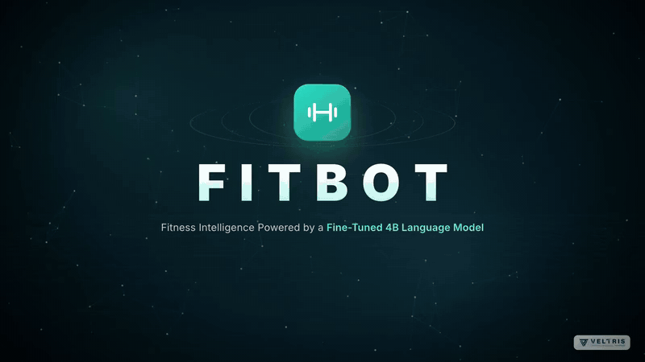

# FitBot

**A fitness assistant that runs on your own Mac, powered by a fine tuned 4 billion parameter language model.**

Ask about workouts, exercises, food, sleep or recovery and FitBot answers like a coach,
with real exercise photos, real USDA nutrition numbers and a plan you can save.

[Watch the film](#the-film) &nbsp;·&nbsp; [See it in action](#screenshots) &nbsp;·&nbsp; [Run it yourself](#run-it-on-your-mac) &nbsp;·&nbsp; [Results](#results)

</div>

---

## The film

[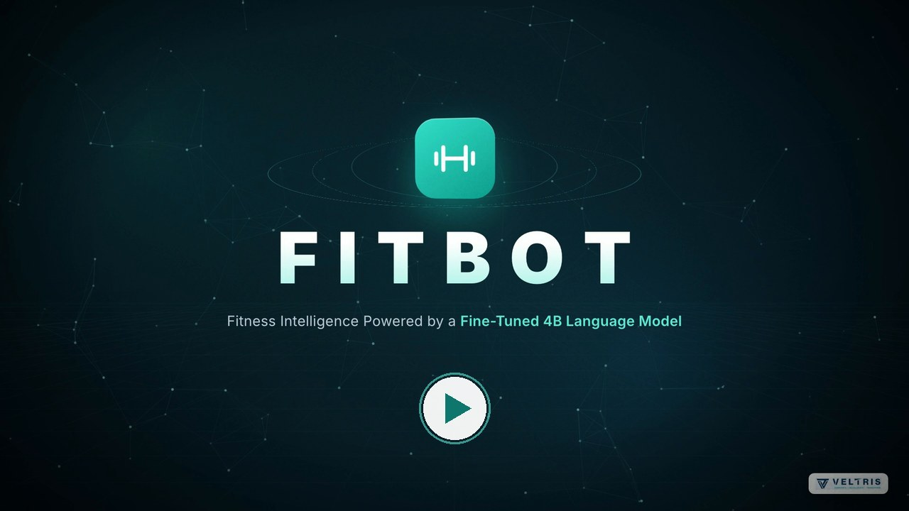](https://raw.githubusercontent.com/Vignan2659/FITBOT-SLM/main/media/FitBot_Launch_Film_1080p.mp4)

A 2 minute 29 second walkthrough of the project in 1080p: the problem, the app, how the model was trained and the measured results.
Click the picture to download the 1080p film (90 MB). It is also in the repo at [`media/FitBot_Launch_Film_1080p.mp4`](media/FitBot_Launch_Film_1080p.mp4).
Everything shown on screen is real output from the app.

## What it does

**Chat like you would with a trainer.** "What exercises can I do for chest?", "Give me a 3 day home plan, I'm a beginner with dumbbells", "What should I eat after working out?" FitBot remembers what you said earlier in the chat, so follow up questions just work.

**Exercise cards with real photos.** 871 exercises from the public domain free exercise database, each with target muscles, equipment, difficulty, instructions and a safety tip.

**Nutrition from USDA FoodData Central.** 111 foods with calories, macros, vitamins and minerals per 100 g or per portion. If a value is not in the USDA data, FitBot does not make one up.

**Yoga.** 63 poses and breathing practices, each with an animated figure that shows the movement from start to final position, step by step instructions, breathing cues, easier and harder versions, and safety notes. Filter by difficulty, goal or body area, open a pose page, or build a timed routine for your goal, level and time of day. In the chat, FitBot answers yoga questions from the same data ("Give me a 15 minute beginner yoga routine", "Which yoga poses target the hips?", "Explain how to perform Warrior II"). More in [docs/YOGA.md](docs/YOGA.md).

**Workout plans.** Beginner to advanced, gym or home, dumbbells or bodyweight, 1 to 6 days a week, with sets, reps and rest.

**My workouts.** Save plans from the chat, log what you trained, and see your weekly activity and streaks.

**Safety first.** Questions about injuries, medication, eating disorders or emergencies get a careful answer and a pointer to a professional. Questions that have nothing to do with fitness are politely declined.

Everything runs locally. No cloud AI service is used and your chats stay in a small database on your own machine.

> FitBot gives general fitness and wellness information. It is not a substitute for professional medical advice.

## Screenshots

<table>
  <tr>
    <td width="50%">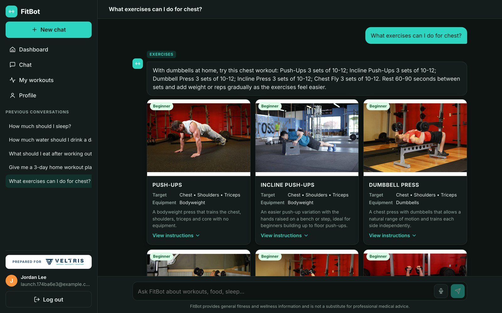<br><sub><b>Exercise cards.</b> Real photos, target muscles and equipment for every exercise.</sub></td>
    <td width="50%">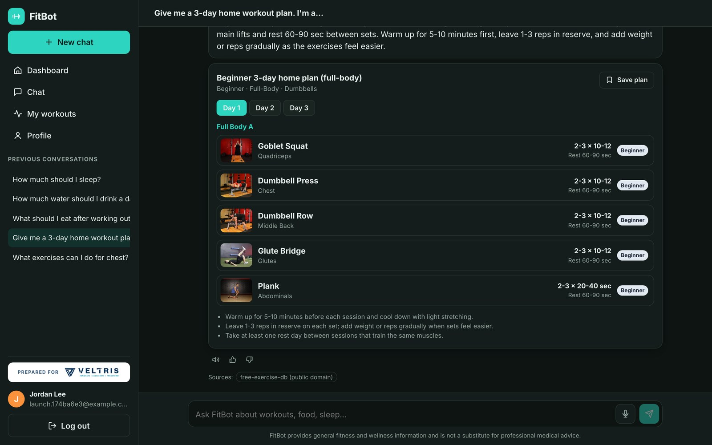<br><sub><b>Personal plans.</b> A 3 day home plan for a beginner with dumbbells.</sub></td>
  </tr>
  <tr>
    <td>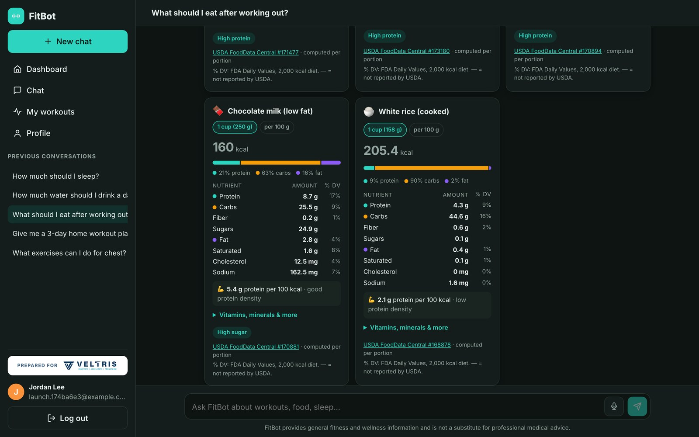<br><sub><b>Nutrition.</b> Values straight from USDA FoodData Central.</sub></td>
    <td>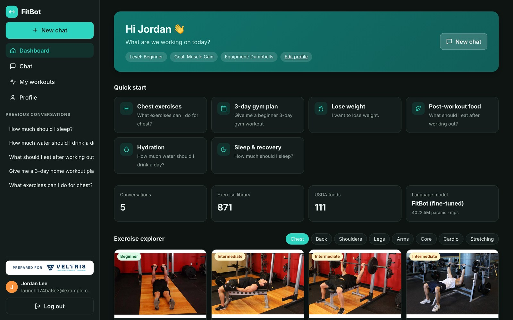<br><sub><b>Dashboard.</b> Quick start questions and the exercise explorer.</sub></td>
  </tr>
  <tr>
    <td>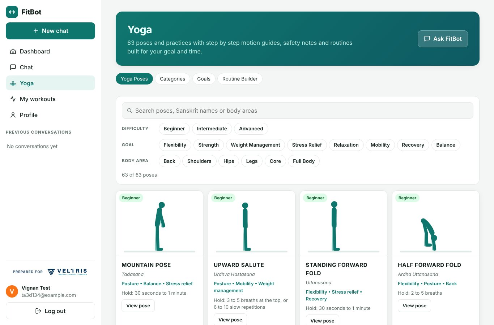<br><sub><b>Yoga.</b> 63 poses with motion figures, filters for difficulty, goal and body area.</sub></td>
    <td>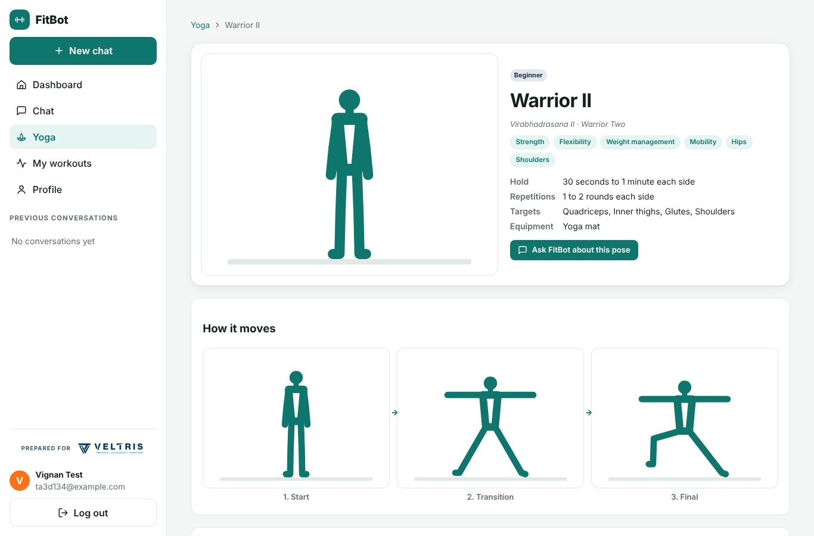<br><sub><b>Pose pages.</b> How the pose moves from start to final position, steps, breathing and safety.</sub></td>
  </tr>
  <tr>
    <td>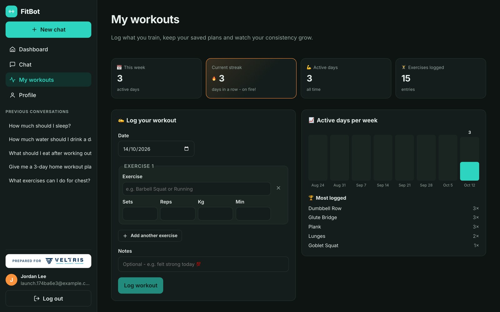<br><sub><b>My workouts.</b> Log sessions, track streaks and your most trained exercises.</sub></td>
    <td>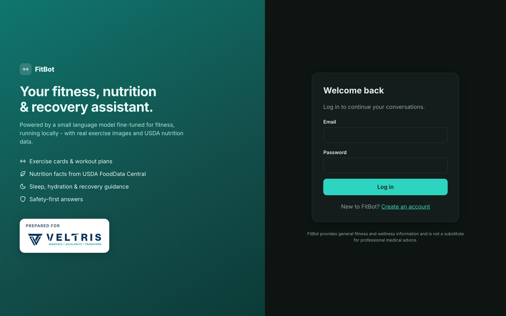<br><sub><b>Accounts.</b> Every user gets a private chat history.</sub></td>
  </tr>
</table>

## How it works

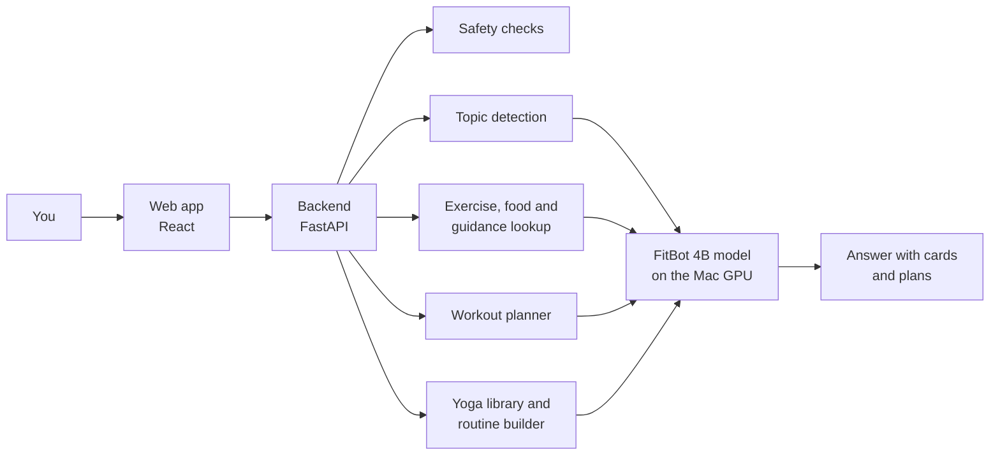

When you ask something, the backend first works out the topic, then looks up the facts the answer needs (exercise details, USDA numbers, yoga poses or a generated plan or routine) and gives them to the model together with your question. The model writes the answer around those facts instead of guessing, and the cards you see come straight from the data.
More detail in [docs/ARCHITECTURE.md](docs/ARCHITECTURE.md).

## The model

| Part | Details |
|---|---|
| Base model | [Qwen3 4B Instruct 2507](https://huggingface.co/Qwen/Qwen3-4B-Instruct-2507), 4.0 billion parameters, Apache 2.0 license |
| Training method | QLoRA: the base model loaded in 4 bit, with small LoRA adapters trained on top (33 million trainable parameters) |
| Training data | 5,470 conversations written for this project from the exercise database, USDA foods, the planner and hand written guidance |
| Training hardware | NVIDIA RTX 4070 with 12 GB, 76 minutes for 2 epochs |
| Runs on | Any Apple Silicon Mac with 16 GB of memory, about 9 to 12 seconds per answer on an M5 |

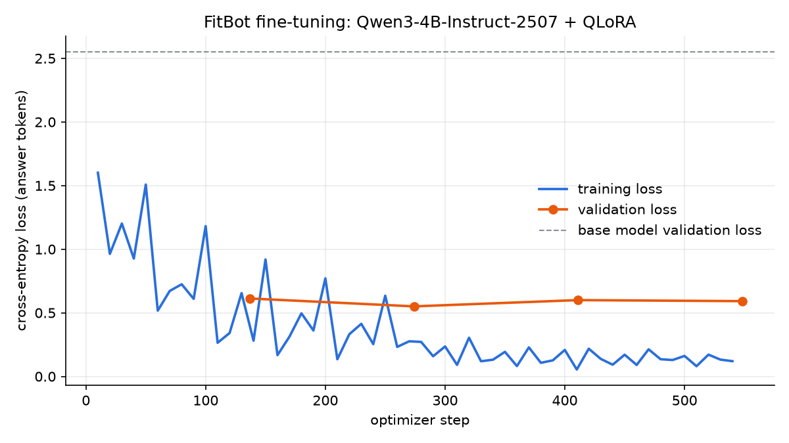

## Results

Tested on questions the model never saw during training.

| | Untrained Qwen3 4B | **FitBot 4B** | FitBot 360M (first version) |
|---|:---:|:---:|:---:|
| Test perplexity (lower is better) | 12.81 | **1.62** | 2.45 |
| Answer similarity to reference answers, 97 original test questions | 0.23 | **0.60** | 0.49 |
| Answer similarity, 80 new test questions | 0.23 | **0.68** | |
| Off topic questions declined | 0% | **100%** | |
| Full app test suite, 163 real questions and conversations | | **93%** | 92% |

Answer similarity is ROUGE L, on a scale from 0 to 1. Fine tuning made the answers almost three times closer to the reference answers than the untrained model.
Full numbers in [docs/EVALUATION.md](docs/EVALUATION.md) and [evaluation/training_run_4b/results.json](evaluation/training_run_4b/results.json).

## Run it on your Mac

**You need**

* A Mac with Apple Silicon (M1 or newer) and at least 16 GB of memory
* About 25 GB of free space
* [Python 3.12](https://www.python.org/downloads/) and [Node.js](https://nodejs.org) (or `brew install python@3.12 node`)
* Internet the first time, for about 8.5 GB of downloads

**Install and start**

```bash
git clone https://github.com/Vignan2659/FITBOT-SLM.git
cd FITBOT-SLM
bash setup.sh
bash start.sh
```

`setup.sh` only has to run once and takes 20 to 40 minutes. It installs the Python packages, builds the web app, downloads the FitBot adapter from the [releases page](https://github.com/Vignan2659/FITBOT-SLM/releases) and the base model from Hugging Face, and combines them into the final model. If it stops halfway, run it again and it picks up where it left off.

When the terminal says `Application startup complete`, open **http://127.0.0.1:8000**, create an account and start asking.

Next time, just run `bash start.sh` or double click **FitBot.command** in Finder. To stop FitBot press Ctrl + C in the terminal.

<details>
<summary><b>Something not working?</b></summary>

| Problem | Fix |
|---|---|
| `python3.12: command not found` | Install Python 3.12 from python.org, open a new terminal and run `bash setup.sh` again. |
| Every message fails with "Request failed (500)" | Run `.venv/bin/pip install scikit-learn==1.9.1` and restart. |
| The Mac gets very slow or says out of memory | Close other apps and browser tabs. The model needs about 10 GB free. Macs with 8 GB are too small. |
| Answers look garbled | Add `FITBOT_DTYPE=bfloat16` to `backend/.env` and restart. |
| `Address already in use` | An old FitBot is still running. `start.sh` stops it for you, or run `lsof -ti:8000 \| xargs kill`. |
| The adapter download fails | Download `fitbot-qwen3-4b-adapter.zip` from the releases page and run `.venv/bin/python scripts/setup_model.py --adapter ~/Downloads/fitbot-qwen3-4b-adapter.zip` |

You can check the model is loaded at http://127.0.0.1:8000/health. It should say `"fine_tuned": true` and `"device": "mps"`.

</details>

<details>
<summary><b>Settings</b></summary>

Settings live in `backend/.env` (see [backend/.env.example](backend/.env.example)). All of them are optional.

| Setting | Default | What it does |
|---|---|---|
| `FITBOT_MODEL_PATH` | `models/fitbot-qwen3-4b/merged` | Which model folder to load |
| `FITBOT_DEVICE` | `auto` | `auto` uses the Mac GPU, `cpu` also works but is slow |
| `FITBOT_DTYPE` | `auto` | Number format on the GPU, try `bfloat16` if answers look wrong |
| `FITBOT_EXERCISES_FILE` | `exercises/exercises_v2.json` | All 871 exercises, or `exercises/exercises.json` for the 58 hand picked ones |
| `FITBOT_MAX_NEW_TOKENS` | `220` | Longest answer the model writes |

</details>

<details>
<summary><b>For developers</b></summary>

Run the backend and the web app separately with live reload:

```bash
cd backend && ../.venv/bin/uvicorn app.main:app --reload --port 8000     # API docs at /docs
cd frontend && npm run dev                                                # http://localhost:5173
```

Tests:

```bash
cd backend && ../.venv/bin/python -m pytest          # 104 backend tests, about 20 seconds
cd frontend && npm test                              # web app tests
.venv/bin/python evaluation/run_test_suites.py --out evaluation/my_results.json   # 163 checks with the real model
```

Training the model again needs an NVIDIA GPU, because 4 bit QLoRA does not run on a Mac. See [docs/TRAINING_GUIDE.md](docs/TRAINING_GUIDE.md).
The film can be made again with `marketing/launch/make_film.command`.

</details>

## What's in this repo

```
FITBOT-SLM/
├── setup.sh, start.sh, FitBot.command   install, start, and a double click launcher
├── backend/          FastAPI server: chat pipeline, model, search, safety, accounts, tests
├── frontend/         React web app
├── data/
│   ├── exercises/    871 exercises (plus the 58 hand picked ones from version 1)
│   ├── nutrition/    111 foods from USDA FoodData Central
│   ├── yoga/         63 yoga poses and practices, plus yoga guidance passages
│   ├── knowledge/    guidance passages used when answering
│   ├── processed_v2/ the 5,470 training conversations
│   ├── processed/    the first dataset (its 97 test questions are used to compare both models)
│   └── image_dataset/ 1,718 cleaned exercise photos split into train, validation and test
├── training/         the QLoRA training notebook and the notebook from the actual run
├── evaluation/       test suites, evaluation scripts and all results
├── models/           topic classifier (the 4B model is downloaded by setup.sh)
├── scripts/          model setup and the scripts that build the datasets (scripts/yoga builds the yoga data and figures)
├── docs/             architecture, datasets, model choice, training and evaluation
├── marketing/        scripts that make the film
└── media/            the film, preview and screenshots used on this page
```

## Data and credits

* Exercises and photos: [free exercise db](https://github.com/yuhonas/free-exercise-db) by yuhonas, public domain (Unlicense)
* Yoga poses, text and motion figures: written and drawn for this project (MIT)
* Nutrition: USDA Agricultural Research Service, FoodData Central, SR Legacy 2018, CC0
* Intent examples: [harshmakwana/fitness-intent](https://huggingface.co/datasets/harshmakwana/fitness-intent), MIT
* Base model: [Qwen3 4B Instruct 2507](https://huggingface.co/Qwen/Qwen3-4B-Instruct-2507), Apache 2.0
* Search embeddings: [all-MiniLM-L6-v2](https://huggingface.co/sentence-transformers/all-MiniLM-L6-v2), Apache 2.0

Built as a college project by [Vignan2659](https://github.com/Vignan2659), presented for Veltris.
The full project report is in [PROJECT_REPORT.md](PROJECT_REPORT.md).

## License

The code and the FitBot data in this repo are released under the [MIT License](LICENSE), copyright 2026 Vignan Karthikeya.
The third party data and models listed above keep their own licenses. The Veltris name and logo that appear in the film and screenshots belong to Veltris and are not covered by this license.
