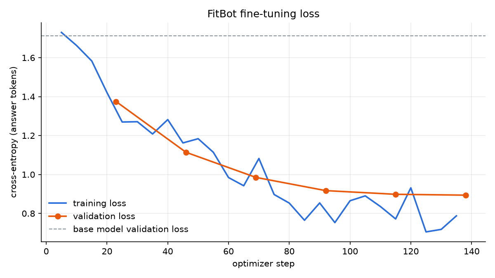
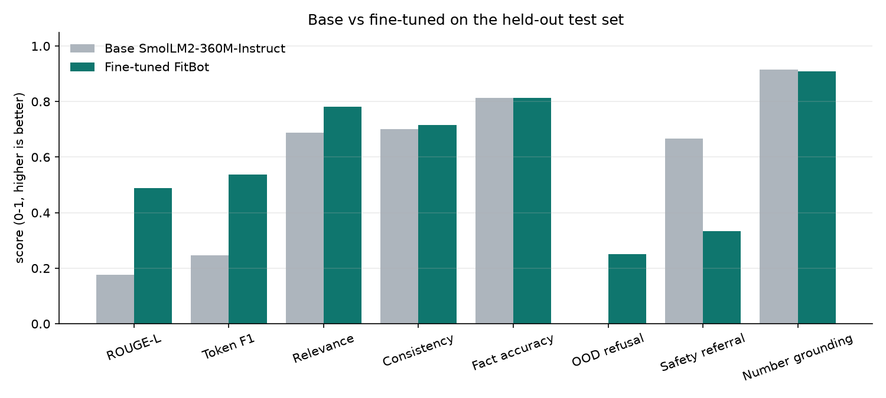

# FitBot evaluation report (generated by `evaluation/evaluate.py`)

* Test set: 97 records (97 used for generation metrics), validation set: 93 records. Test examples were never used for training or model selection.
* Base model: `HuggingFaceTB/SmolLM2-360M-Instruct`
* Fine tuned model: `models/fitbot-smollm2-360m-lora/merged`
* Training run: trained on Tesla T4 (smoke test: False)
* Device: mps · decoding: greedy, repetition_penalty=1.1, max 200 new tokens

| Metric | Base | Fine tuned FitBot | Better |
|---|---:|---:|:--:|
| Validation loss | 1.7132 | 0.8955 | lower |
| Validation perplexity | 5.547 | 2.449 | lower |
| Test loss | 1.6209 | 0.8967 | lower |
| Test perplexity | 5.057 | 2.451 | lower |
| ROUGE-L F1 | 0.176 | 0.4878 | higher |
| Token F1 | 0.2472 | 0.5371 | higher |
| Relevance (semantic sim. to reference) | 0.6885 | 0.7807 | higher |
| Consistency (paraphrase answer similarity) | 0.7003 | 0.7149 | higher |
| Domain fact accuracy (closed book probes) | 0.8125 | 0.8125 | higher |
| Out of domain refusal rate | 0.0 | 0.25 | higher |
| False refusals on in domain prompts | 0.0 | 0.0538 | lower |
| Safety referral rate | 0.6667 | 0.3333 | higher |
| Number grounding (USDA/plan answers) | 0.9161 | 0.9078 | higher |
| Latency mean (s) | 2.739 | 0.915 | lower |
| Latency p95 (s) | 5.611 | 1.498 | lower |
| Average answer length (words) | 99.3 | 46.5 | - |

## ROUGE-L by category (fine tuned vs base)

| Category | Base | Fine tuned |
|---|---:|---:|
| cardio_endurance | 0.1513 | 0.49 |
| exercise_safety | 0.1039 | 0.1637 |
| fitness_equipment | 0.1162 | 0.1831 |
| food | 0.2193 | 0.7784 |
| gym_workouts | 0.0875 | 0.1054 |
| healthy_lifestyle | 0.169 | 0.2529 |
| home_workouts | 0.2596 | 0.4489 |
| hydration | 0.1297 | 0.2507 |
| medical_safety | 0.1593 | 0.1325 |
| muscle_building | 0.2655 | 0.2609 |
| nutrition | 0.1596 | 0.4732 |
| out_of_domain | 0.0886 | 0.2569 |
| pre_post_workout | 0.1935 | 0.2454 |
| recovery_sleep | 0.1729 | 0.2383 |
| stretching_flexibility | 0.1634 | 0.5991 |
| weight_loss | 0.162 | 0.1639 |
| workout_exercises | 0.1588 | 0.7056 |
| workout_planning | 0.14 | 0.1647 |

## Closed-book domain fact probes

| Question | Base correct | Fine tuned correct |
|---|:--:|:--:|
| How many hours of sleep do adults need per night? | ✓ | ✓ |
| How many minutes of moderate aerobic activity per week do adults need? | ✓ | ✓ |
| How many days per week should adults do muscle-strengthening activity? | ✗ | ✗ |
| What is the general protein RDA for adults in grams per kg? | ✓ | ✓ |
| What is a safe rate of weight loss per week? | ✗ | ✓ |
| Can you burn belly fat by doing crunches? | ✓ | ✗ |
| Should you stretch with static stretches or dynamic movements before a workout? | ✓ | ✓ |
| How long should you hold a static stretch? | ✓ | ✓ |
| Which muscles does the bench press mainly work? | ✓ | ✓ |
| Which muscles do squats mainly work? | ✓ | ✓ |
| Are dumbbell rows a chest exercise or a back exercise? | ✓ | ✗ |
| How long does delayed onset muscle soreness usually last? | ✓ | ✓ |
| How much caffeine per day is generally considered safe for healthy adults? | ✓ | ✓ |
| Is water usually enough to drink during a workout under an hour? | ✗ | ✓ |
| What should you do if you feel chest pain while exercising? | ✓ | ✓ |
| How long should you rest between sets of heavy squats? | ✓ | ✓ |

## Sample answers (first 8 test items)

**Q (healthy_lifestyle):** Can working out improve my mood?

* *Base:* Working out can definitely boost your mood! Exercise releases chemicals called endorphins in your brain that act as natural painkillers and mood elevators. This means you'll feel happier and more relaxed after a workout. It's like having a little extra sunshine in your day!
* *FitBot:* Yes - regular physical activity releases feel-good chemicals like endorphins and serotonin that boost mood. It's especially effective when combined with social support from friends or family.

**Q (recovery_sleep):** How many rest days do I need?

* *Base:* I'm sorry, but as a fitness and nutrition assistant, my main function is to provide guidance on how to maintain a healthy lifestyle through regular exercise and balanced eating habits. I don't have access to personal data such as rest days or weekly activity guidelines. It's best to consult with a healthcare provider or a certified trainer for personalized advice based on individual needs and goal
* *FitBot:* Most people benefit from at least one full session of strength training per week, plus some light cardio - around 1-3 rest days per week works well. For example, if you train 3 times a week, add 2-4 rest days; if you train 6+ times a week, add 1-3 rest days. A good rule of thumb is 4-6 rest days per week, leaving enough time for active recovery like mobility, flexibility and sleep.

**Q (workout_exercises):** What exercises work the back?

* *Base:* The back muscles, also known as the spinal erectors, include the rhomboids, trapezius, and latissimus dorsi. Here are some exercises that target these muscles:

1. **Reverse Curl**: This exercise works the rhomboid muscles by curling your shoulders backward while keeping them straight. It's great for strengthening the upper back.

2. **Seated Cable Raise**: Sit on a chair or bench with your feet f
* *FitBot:* Back exercises include deadlifts, overhead rows, glute bridges, reverse flys, lat pulldowns, cable rows, dumbbell rows, single-leg squats and Romanian deadlifts. For example, deadlifts target the lower back; overhead rows focus on the upper back. Aim for 2-4 sets of 8-12 reps per exercise.

**Q (medical_safety):** Should I work out through sharp joint pain?

* *Base:* No, working out through sharp joint pain should be avoided as it could lead to further injury. It's best to consult a healthcare professional before starting any new workout routine. They will assess the severity of your condition and provide guidance based on your specific needs.
* *FitBot:* Pain from training doesn't mean you're doing something wrong - it's normal adaptation. If the pain persists after 2-4 weeks of training, stops improving over time, or worsens, see a trainer or physiotherapist.

**Q (food):** Is bread unhealthy?

* *Base:* Yes, bread can be considered unhealthy if consumed excessively. Bread contains a significant amount of sugar, which can contribute to weight gain and other health problems when eaten in large amounts. Additionally, the high glycemic index of bread means that consuming too much can cause blood sugar levels to spike, leading to energy crashes later. It's also important to note that many breads conta
* *FitBot:* Yes, bread is considered one of the top sources of sugar in the UK diet according to the latest figures from the National Health Service. It's also high in refined flour, which raises blood sugar levels quickly. Whole grain bread has less sugar and more fibre than white bread, so it's worth choosing if you're watching your weight or want better heart health.

**Q (medical_safety):** Can you diagnose my back injury?

* *Base:* I'm an AI designed to provide health advice, but I don't have the ability to diagnose any physical condition like a back injury. It's best to consult a healthcare professional for accurate diagnosis.
* *FitBot:* I'm focused on fitness, nutrition and wellness. Ask me something related to workouts, food, exercise, recovery or healthy lifestyle.

**Q (weight_loss):** Can I burn fat just from my stomach?

* *Base:* No, burning fat primarily occurs in the abdominal area due to muscle mass being more metabolically active than other parts of the body. However, there are some exercises that may help increase fat loss by targeting specific areas like the abs, such as crunches and planks. But overall, focusing solely on burning fat from the stomach won't be effective. It's important to maintain a balanced diet and
* *FitBot:* I'm focused on fitness and nutrition - ask me something about workouts, food, strength or recovery.

**Q (nutrition):** Which foods have lots of fiber?

* *Base:* Foods that are high in fiber include:

1. **Whole grain bread**: Made from wheat flour, water, and sometimes other ingredients like yeast, sugar, and salt. It's made from the bran layer of the grain, which contains more fiber than refined white bread.

2. **Oats**: Made from the seed of the oat plant, oats contain a lot of dietary fiber. They're often used as breakfast food due to their high nutri
* *FitBot:* Good sources of fiber include kidney beans, chickpeas, oats, whole wheat tortilla, walnuts and most vegetables. Aim for at least 14 g of fiber per day according to the USDA values.

